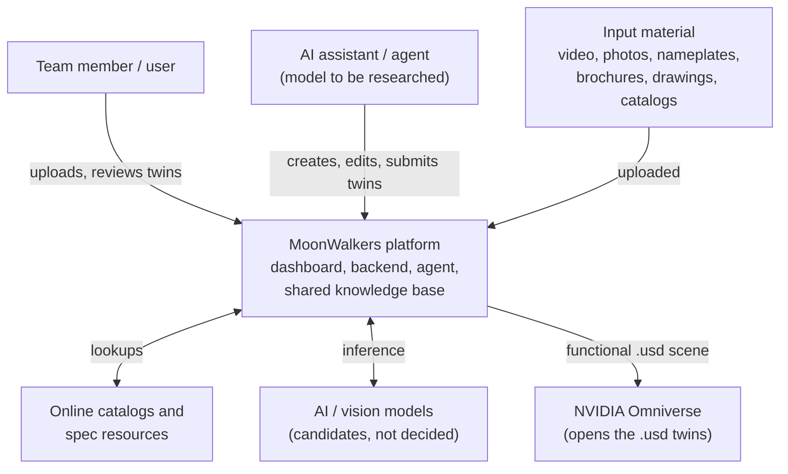
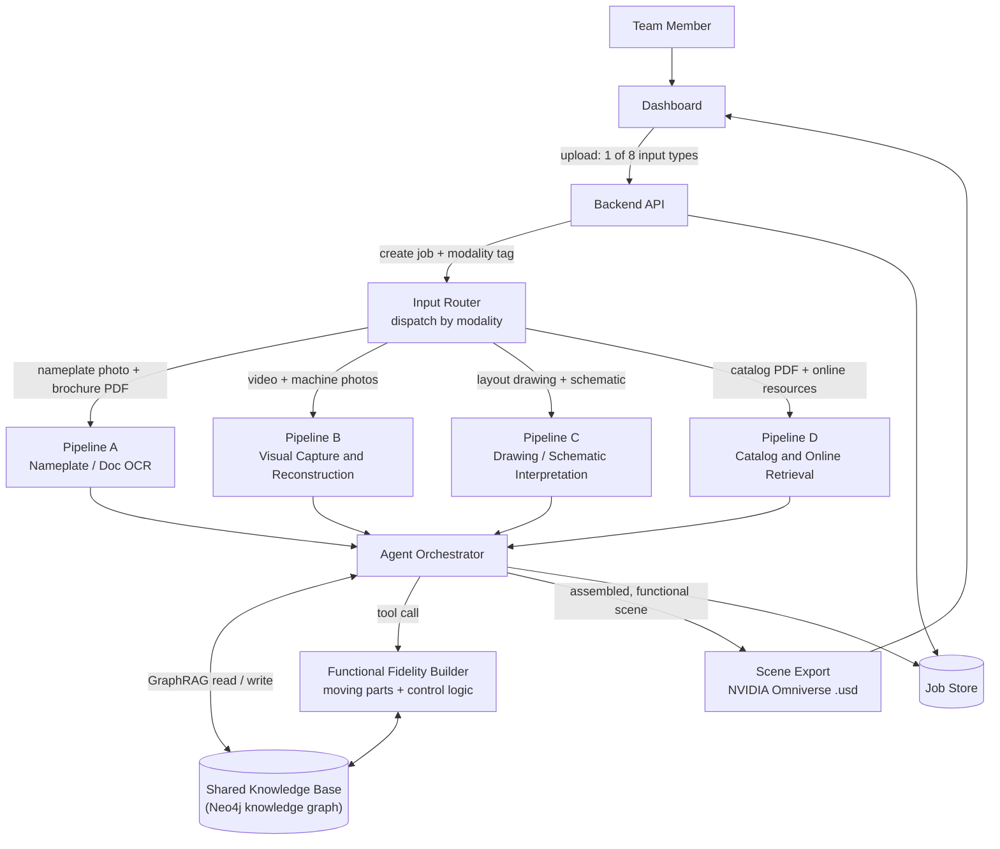
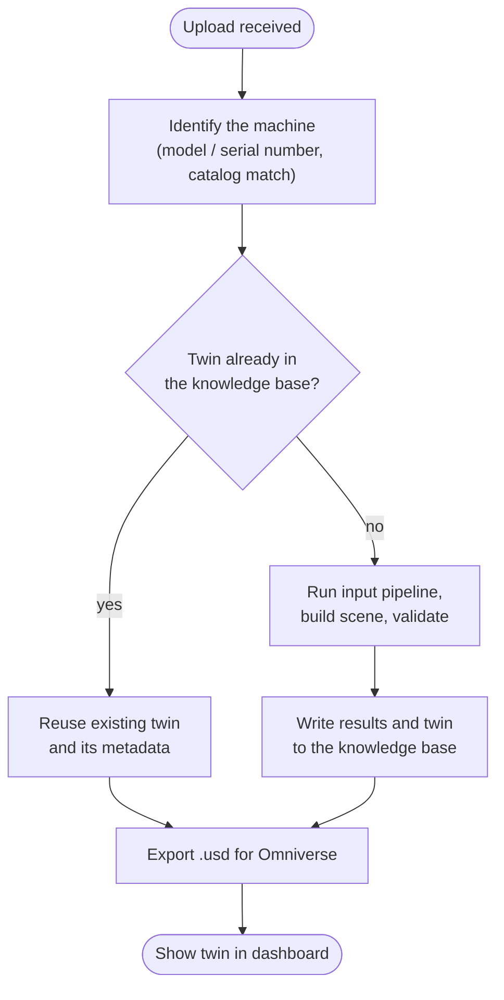
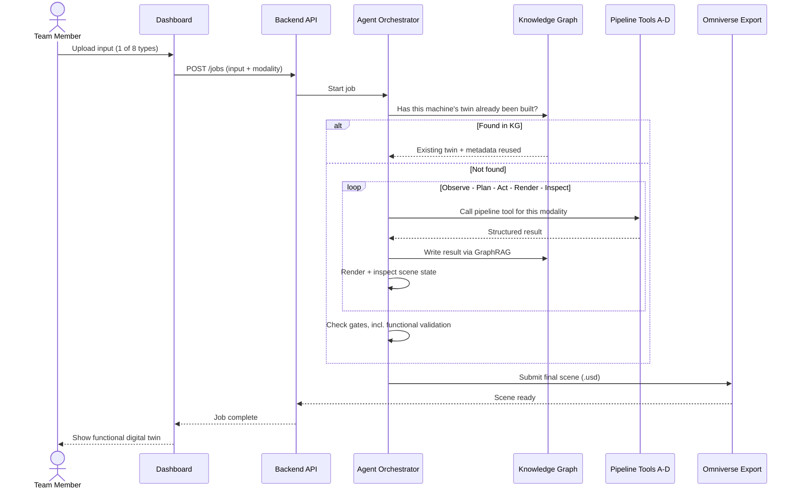
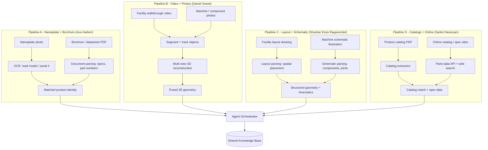
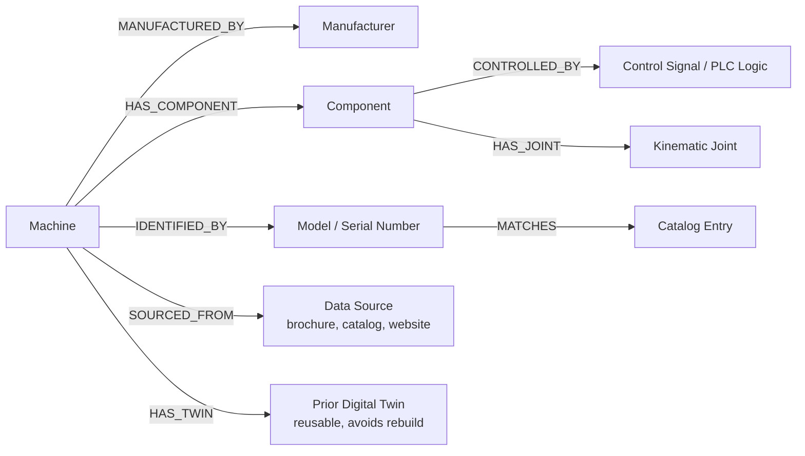
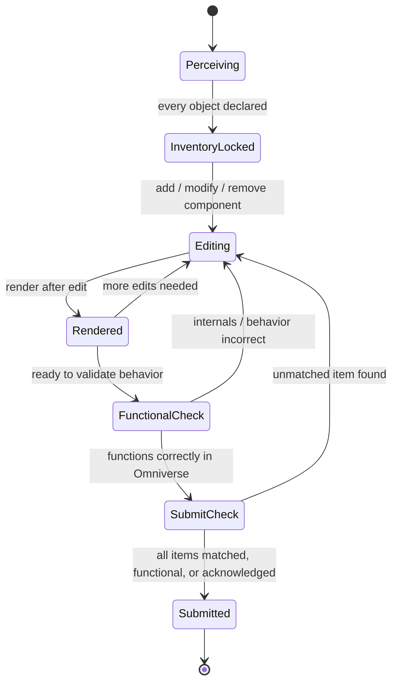
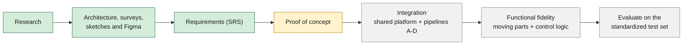

# MoonWalkers Multimodal Agentic Digital Twin Generation Platform

A multimodal AI-agent platform that turns everyday facility and equipment information (walkthrough video, photos, nameplates, brochures, drawings, catalogs) into **functional digital twins** exported as **NVIDIA Omniverse-compatible `.usd`** scenes, and stores what it learns in a shared knowledge base so a machine's twin never has to be rebuilt from scratch.

A capstone contribution to the **MoonWalkers collaborative platform** at CSUN's **ARCS** (Autonomy Research Center for STEAHM), built by a four-person team with guidance from faculty and NASA JPL advisors.

---

## Project status

**Proof of concept in progress: Phases 0 (scaffold) and 1 (knowledge base and orchestrator core) are
done.** The orchestrator stores twin records, reuses a stored twin on a second request, and re-versions
on request, using stub pipelines; no 3D model or `.usd` is generated yet.

| Area | Status |
|---|---|
| Background research (digital twins, image-to-3D models, agents, prior MoonWalkers work) | Done |
| Scope and goals | Defined (see [What it does](#what-it-does)) |
| Architecture design, surveys, sketches and Figma wireframes | Done |
| Software Requirements Specification (SRS) | Complete as of October 8th, 2026, written section by section by the team and awaiting stakeholder approval |
| Technology stack | **Decided (Oct 16, 2026):** see [Technology stack](#technology-stack) |
| Proof of concept | **In progress.** Phases 0-1 done; Phase 2 (USD export) next. See [docs/poc-plan.md](docs/poc-plan.md) |
| Shared platform (dashboard, backend, knowledge base) | Backend: pipeline contract, Input Router, orchestrator core (reuse and re-versioning), and a JSON-file knowledge base, all tested. Dashboard: Vite + React + TypeScript starter page |
| Input pipelines | Pipelines A, C, D are stubs returning cited HA5C fixture data; Pipeline B (photos) is built in Phase 3. All four have an owner (see [The four pipelines](#the-four-pipelines)) |

Everything below describes the **planned design**. Anything marked *candidate* or *to be researched* has not been decided by the team.

---

## What it does

1. A user uploads one of up to **eight input types** through a dashboard.
2. An **agent** checks the shared knowledge base: has this machine's twin already been built?
3. If yes, it reuses the existing twin. If not, it runs the right input pipeline, writes what it learns to the knowledge base, builds and inspects the scene, and validates it.
4. The result is exported as a `.usd` scene that opens in NVIDIA Omniverse.

### What "functional" means here

The goal is a twin that **behaves like the real machine, not just looks like it**. The definition, set by the team on Oct 5, 2026 and confirmed by our advisors, is both:

- **Moving parts** (articulation), and
- **Control logic** (how the machine is driven).

For example, a CNC machine's twin should have correct internals and behave like one in Omniverse, rather than being a hollow shell. The team has set this as the goal even though the semester may not leave time to deliver all of it; the requirements are written as if time is available.

Builds are expected to take a *reasonable amount of time*: not real-time, not exorbitant. For now there is no target time; the target is the result, and time metrics will come from testing.

Every fact attached to a twin (a spec value, a dimension, a manual) shows the user where it came from.

### The eight input types

| # | Input | Pipeline |
|---|---|---|
| 1 | Video of a facility walkthrough | B |
| 2 | Photos of machines / components | B |
| 3 | Photos of equipment nameplates | A |
| 4 | PDF product brochures / datasheets | A |
| 5 | Facility layout drawings | C |
| 6 | Schematic illustrations of machines | C |
| 7 | PDF product catalogs | D |
| 8 | Online product-catalog / technical-spec resources | D |

Each team member builds the pipeline for two inputs after the shared platform exists. Owners are listed under [The four pipelines](#the-four-pipelines).

---

## Architecture (planned)

### System context

Who and what the platform talks to. The aim is for an AI assistant or agent to drive the platform to create, edit, and submit twins. No specific AI model is named, because the model and agent runtime are still to be researched.

### Component view

The Input Router sends each upload to one of four pipelines. Every pipeline reports to the agent orchestrator, which reads and writes the shared knowledge base, calls the Functional Fidelity Builder, and exports the scene.

### Twin reuse: the request flow

The knowledge base is checked first so that a machine already modeled is never rebuilt.

### Agent loop

### The four pipelines

Each pipeline handles a pair of inputs and has one owner. The models named in each box are **candidates from the team's research**, not final choices.

| Pipeline | Owner | Inputs | Candidate techniques (from research) |
|---|---|---|---|
| A | Ava Harken | Nameplate photos, brochures/datasheets | Ocean-OCR for scene text; document parsing |
| B | Daniel Sweet | Walkthrough video, machine/component photos | SAM 3 / SAM 2 for segmentation and tracking; VGGT for multi-view reconstruction |
| C | Shankar Kiran Ragavender | Layout drawings, schematic illustrations | Drawing/schematic interpretation to structured geometry and kinematics (approach not chosen) |
| D | Sarkis Nazaryan | PDF catalogs, online catalogs/specs | Catalog extraction; Octopart-style parts APIs for electronic components; web search for other equipment |

### Knowledge base schema (draft)

A draft of the entities and relationships the knowledge base would hold. It is a starting point for the SRS and will change. The `CONTROLLED_BY` and `HAS_JOINT` edges are what would let the Functional Fidelity Builder connect a machine's control logic to its physical structure.

### Submission gates

The agent cannot submit a scene until it passes these checks. `FunctionalCheck` separates "looks right" from "behaves right in Omniverse".

---

## Technology stack

**Decided Oct 16, 2026 (Option A).** Our advisors left the stack to us.

| Layer | Choice |
|---|---|
| Backend | Python, FastAPI |
| Task queue | Celery |
| Dashboard | React + TypeScript (barebones first) |
| Packaging | Docker |
| Knowledge base | Neo4j through its Python driver; the proof of concept uses a simple store behind the same interface |
| Output | OpenUSD (`.usd`) for NVIDIA Omniverse and Isaac Sim, targeting the most recent releases |
| AI model and agent runtime | To be researched while we build |

Two alternatives were considered in our Oct 6 research: an all-Python stack with a Gradio interface, and a Node/TypeScript backend with Python workers. The similar projects we reviewed (including two from Dr. Li's lab, AHa-3D, and NVlabs SAGE) are all Python-based. NVIDIA's Omniverse Web Viewer sample is React + TypeScript + Vite, so a live 3D view in the dashboard (a wish, not a requirement) is possible in principle. Isaac Sim's own livestream has no authentication or encryption, which matters for any shared deployment.

### Hardware notes

- For now we run a locally hosted instance on the team's own GeForce RTX 4090 (24 GB) under Windows 11.
- The latest Isaac Sim release is 6.2.0 (October 2026). Its requirements page lists Ubuntu 22.04/24.04 or Windows 11, a minimum of GeForce RTX 4080 (16 GB), and states that GPUs without RT Cores (A100, H100) are not supported.
- TRELLIS.2, one candidate image-to-3D model, lists a requirement of an NVIDIA GPU with at least 24 GB; its README says it was verified on A100 and H100 and tested only on Linux.

---

## Proof of concept

In progress (Phases 0-1 of [docs/poc-plan.md](docs/poc-plan.md) done). It must show that an AI agent can create a digital twin, in some capacity, from one input type.

- **Input:** machine photos to start (video is required in the final product), sourced online until test photos from Dr. Li's lab arrive.
- **Subject:** one well-known, relatively simple machine that has joints and control logic.
- **Minimum result:** a scaled 3D model with cited facts; the aim is also one working joint, then control logic.
- **Pass criteria:** the `.usd` opens in the target Isaac Sim version, a joint moves, and a second request for the same machine reuses the stored twin and says so.
- **Human review:** expected in v1; later versions will let the user set how much human input is needed.

## Test data

The faculty advisor suggested a small, standardized test set: his own lab as a controlled capture environment (test inputs are coming from his lab), plus product data from six websites (BHS, Inc.; Made-in-China.com; Wheeler Machinery Sales; Grizzly Industrial; MASCO; and a Haas Automation model guide). These sources vary in reliability; the marketplace site in particular needs spot-checking.

---

## Roadmap

Planned order of work. Green is done, yellow is current. No dates are committed yet.

---

## Open decisions

| Decision | State |
|---|---|
| AI model and agent runtime | To be researched while we build |
| Owners for non-pipeline components | Deferred until the proof of concept works |
| Live 3D view in the dashboard | Wished for, not a requirement |
| Time targets for a build | None for now; metrics will come from testing |
| Using a "digital cousin" as a fallback (in the ACDC paper, an asset that does not model a specific real-world counterpart but keeps similar geometry and semantics) | Accepted by our advisors for later; not in the proof of concept |
| Spatial Web (HSML/HSTP) interoperability | Stretch goal |
| Milestone dates | To be defined |

Decided on Oct 16, 2026: the technology stack (Option A), Neo4j for the knowledge base, the product name, the pipeline-to-orchestrator data flow, the definition of "functional", and the proof-of-concept scope.

---

## Related work

- Fei-Fei Li's lab: *Automated Creation of Digital Cousins for Robust Policy Learning* (ACDC), [arXiv:2410.07408](https://arxiv.org/abs/2410.07408)
- Dr. Li's lab (GitHub organization): [Digital-Twin-Interoperability](https://github.com/Digital-Twin-Interoperability), including [isaac-sim-reconstruction-benchmark](https://github.com/Digital-Twin-Interoperability/isaac-sim-reconstruction-benchmark) and [Automated-Digital-Twin-Generation-Pipeline](https://github.com/Digital-Twin-Interoperability/Automated-Digital-Twin-Generation-Pipeline)
- [AHa-3D](https://github.com/KevinXu02/aha-3d) and [NVlabs SAGE](https://github.com/NVlabs/sage): similar scene-generation pipelines
- Knowledge graphs for functional twins: [arXiv:2606.03255](https://arxiv.org/pdf/2606.03255), which links a machine's control logic to its kinematic model through a knowledge graph
- Articulation from images, text, or point clouds: [Articulate-Anything (arXiv:2410.13882)](https://arxiv.org/abs/2410.13882) and [URDF-Anything (arXiv:2511.00940)](https://arxiv.org/abs/2511.00940)
- Candidate perception models: [SAM 3](https://ai.meta.com/research/sam3/), [VGGT](https://arxiv.org/abs/2503.11651), [Ocean-OCR](https://arxiv.org/pdf/2501.15558), [TRELLIS.2](https://github.com/microsoft/TRELLIS.2)
- Prior MoonWalkers work: *Enabling Interoperable Digital Twins for Collaborative Lunar Exploration*, IEEE Aerospace 2025, [DOI 10.1109/AERO63441.2025.11068549](https://doi.org/10.1109/AERO63441.2025.11068549)
- Platform documentation: [Isaac Sim requirements](https://docs.isaacsim.omniverse.nvidia.com/latest/installation/requirements.html), [NVIDIA Omniverse Web Viewer sample](https://github.com/NVIDIA-Omniverse/web-viewer-sample), [GraphRAG vs. vector RAG (Neo4j)](https://neo4j.com/blog/agentic-ai/vector-rag-vs-graphrag/)

---

## Team

California State University, Northridge (CSUN), Computer Science capstone.

| Name | Role |
|---|---|
| Daniel Sweet | Technical lead; Pipeline B (video + machine/component photos) |
| Ava Harken | Product owner; Pipeline A (nameplates + brochures/datasheets) |
| Sarkis Nazaryan | Pipeline D (PDF catalogs + online catalog/spec resources) |
| Shankar Kiran Ragavender ("Kiran") | Pipeline C (layout drawings + schematics) |

**Course instructor:** Professor Xunfei Jiang

**Advisors and stakeholders:**

- Dr. Bingbing Li, faculty advisor and project stakeholder (Associate Director of ARCS; Associate Professor, Manufacturing Systems Engineering and Management, CSUN)
- Dr. Thomas Lu, senior researcher at NASA JPL; advisor to the team and a project stakeholder

---

## Repository contents

| Path | What it holds |
|---|---|
| `CLAUDE.md` | Project instructions for Claude Code (rules, layout, commands, workflow) |
| `.claude/settings.json` | Shared Claude Code permissions (tests, commits, and PRs allowed; installs ask first) |
| `docs/methodology.md` | How we work: research, decide, build, verify, document |
| `docs/poc-plan.md` | Proof-of-concept phases and checkboxes |
| `docs/decisions/` | Decision records (stack, PoC scope, agent, contract, knowledge base, generator, Phase 0 tooling, KB store, twin reuse and versioning) |
| `docs/worklog/` | Dated work entries |
| `docs/research/` | Research notes and the project context file |
| `docs/setup/` | Windows and Hugging Face setup guides |
| `backend/` | Python package `moonwalkers` (`uv` project, Python 3.12): the shared pipeline contract and its JSON Schema, knowledge base (`kb/`), orchestrator and Input Router (`orchestrator/`), pipeline stubs (`pipelines/`), and tests |
| `dashboard/` | Vite + React + TypeScript app (starter page for now) |
| `data/` | Local test data and outputs (gitignored except its README) |

More source code arrives phase by phase; see `docs/poc-plan.md`. Commands to install, test, and run
everything are in the "Commands" section of `CLAUDE.md`.

## License

No license has been chosen yet for this repository. Until one is added the default copyright applies, meaning no one else may reproduce, distribute, or create derivative works from the code.
