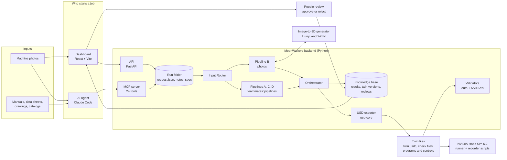
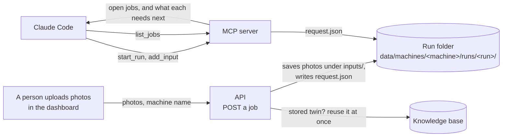
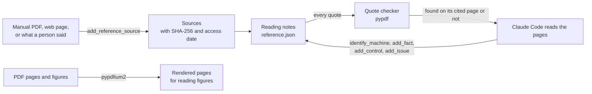
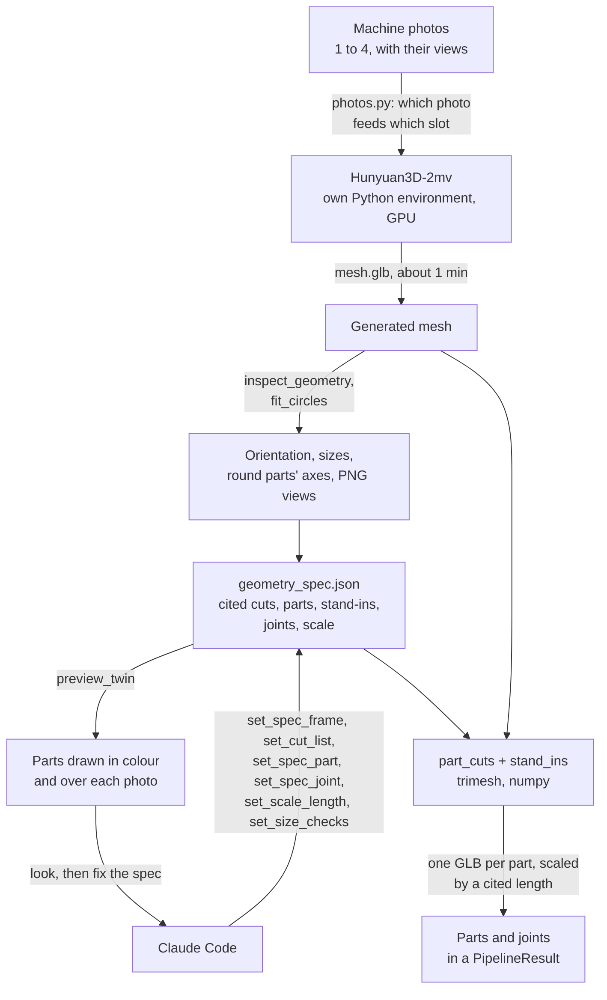
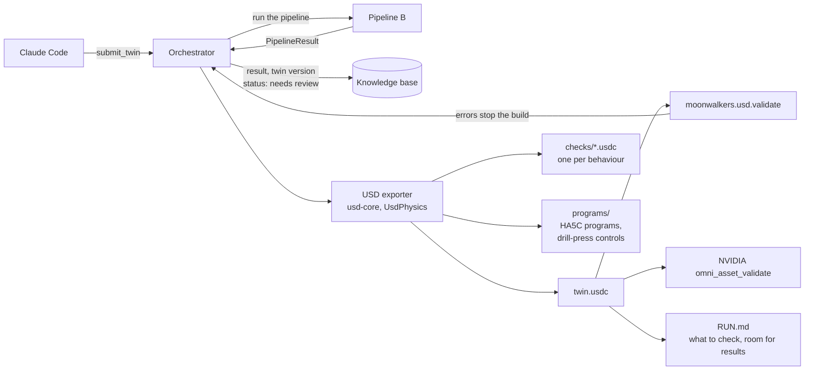
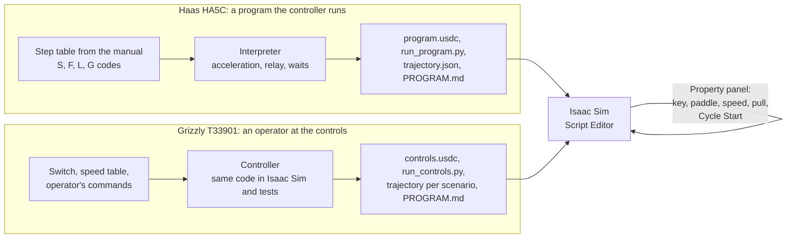
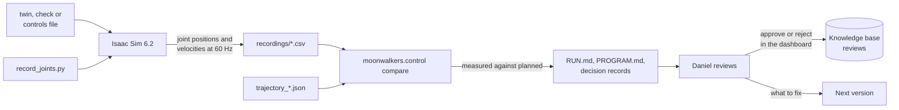
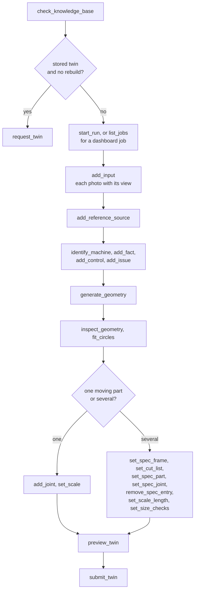

# How MoonWalkers builds a digital twin

From a machine's photos and documents to a twin that moves and is controlled in NVIDIA Isaac Sim.
Each step names the tools it uses, with what goes into and comes out of them. The
[tool guide](tool-guide.md) explains every tool by name: what it is, why we use it, and its inputs
and outputs.

The diagrams are Mermaid, which GitHub draws on this page. Written on 2026-11-02, as built at the
end of the drill-press plan's Phase 6 (`docs/drill-press-plan.md`). The Grizzly T33901 drill press
and the Haas HA5C indexer are the worked examples.

## 1. The whole path

- **A twin is reused when it exists.** Before building, the orchestrator looks the machine up by its
  key (`grizzly/t33901`). It returns the newest approved version, else the newest that nobody
  rejected (decision 0015).
- **Every fact cites its source,** from the photo or page it came from to the twin file that uses it
  (rule 1).
- **Only the orchestrator writes to the knowledge base.** Pipelines return a `PipelineResult`, the
  shared contract (decision 0004; v0.2.0, decision 0020).

## 2. Starting a job

- **In:** photos, each with the side it shows in the operator's words (decision 0022), and the
  machine's maker and model.
- **Out:** a run folder, the job. The API never runs the generator; the agent continues the job
  (decision 0014).

## 3. Reading the documents: cited notes

- **In:** documents and photos of documents.
- **Out:** the machine's identity, its facts in SI units (sizes, speeds, travels), its control
  behaviours, and issues for a reviewer. Each one carries a citation: a source, a page or locator,
  and a short quote.
- **Example:** the T33901's reference file holds 36 facts and 3 control behaviours. Its 59 quotes
  were all found on their pages on 2026-10-30.

## 4. Photos to a mesh, and the mesh to parts (Pipeline B)

- **In:** photos, and the cited notes.
- **Out:** the twin's parts (cut from the mesh, or labelled stand-ins where the mesh hides or gets a
  part wrong), its joints with their behaviour (spring return, locked, free, driven, follows
  another), and size checks against every cited length.
- **Example:** `grizzly/t33901@v8` has 17 parts (11 stand-ins) and 16 joints (9 fixed). It is
  scaled by the cited 39 in height, and checked against 6 more cited lengths.

## 5. Building, exporting and validating

- **In:** a run folder with its photos, notes and spec.
- **Out:**
  - the twin as OpenUSD (`.usdc`), with articulation joints, drives, limits and couplings that
    Isaac Sim simulates;
  - a check file per behaviour;
  - program or control folders;
  - `RUN.md`;
  - a new twin version in the knowledge base.
- **A version is stored for good,** so a dry run in a scratch copy of the data folder comes first.

## 6. Control logic (success level 3)

- **In:** control behaviours cited from the manual (decisions 0016, 0025, 0026).
- **Out:** a twin that the machine's own control drives on every physics step: the HA5C's indexing
  programs, and the T33901's keyed switch, twelve speeds and drilling stroke. The T33901's controls
  can be operated live in the Property panel.

## 7. Checking in Isaac Sim, measuring, and reviewing

- **In:** a person opens the file and runs the recorder.
- **Out:** measured numbers against the plan. For example, on 2026-11-02 the T33901's stroke
  reached its depth stop at 12.12 s against 12.13 s planned, and its spring returned the quill in
  0.28 s.
- **The agent never reviews:** approving or rejecting a version is a person's decision (decision
  0015).

## 8. The agent's tools, in the order it uses them

The procedure the agent follows is `docs/agent-procedure.md`. Each tool's inputs and outputs are
in the [tool guide](tool-guide.md#the-agents-24-mcp-tools).
